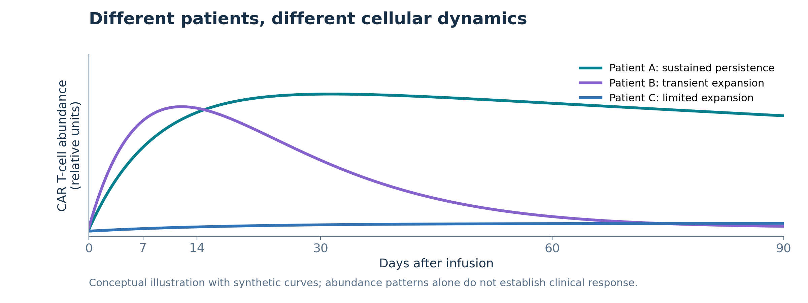
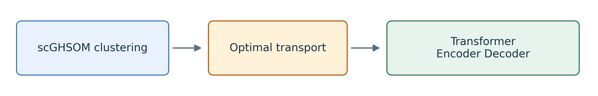
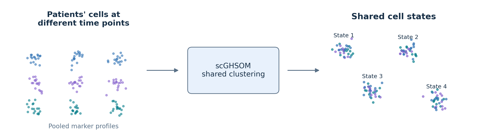
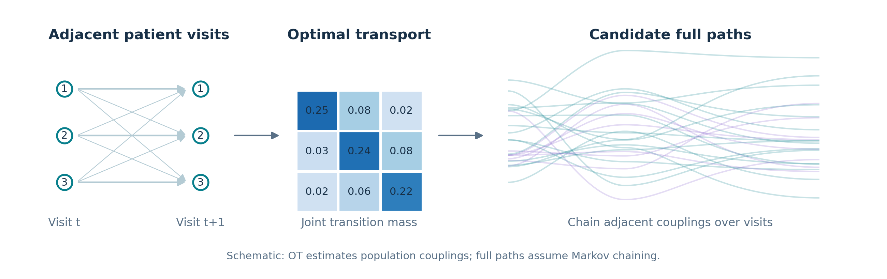
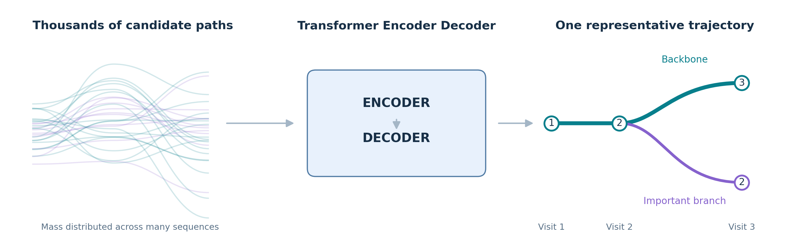
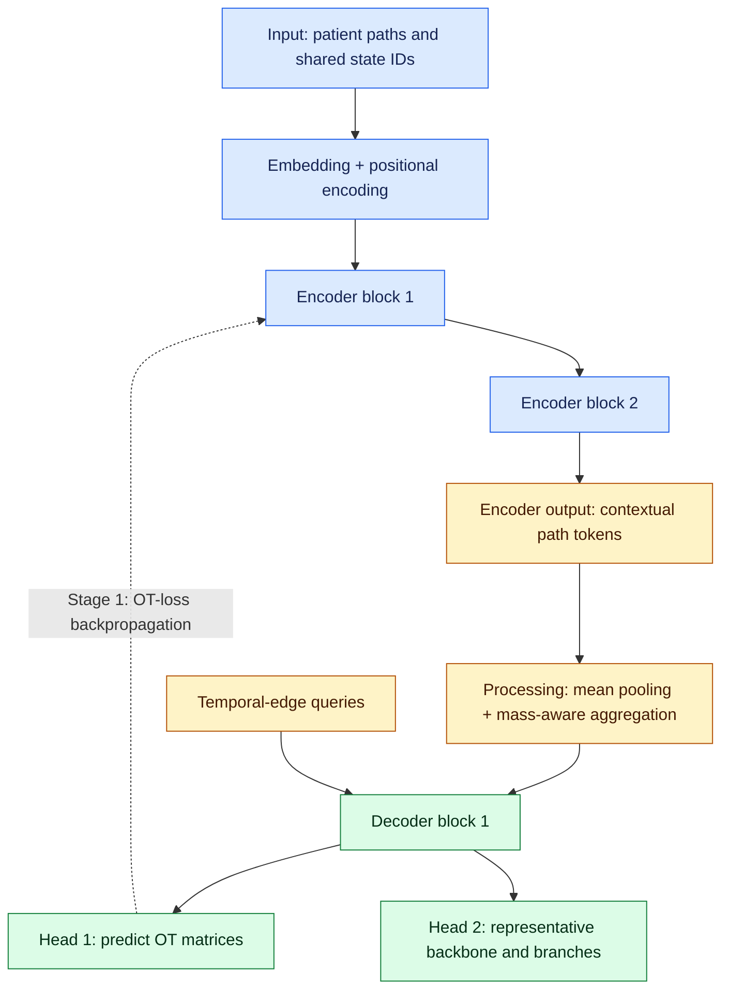
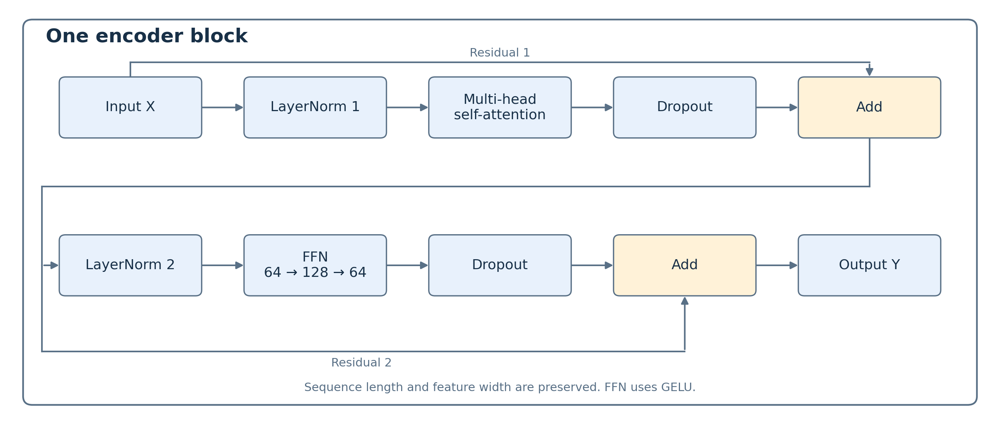

# OT-Transformer Encoder Decoder for CAR-T Cell-State Trajectories

## Why follow cell states over time?

CAR-T therapy modifies T cells to recognize and attack cancer cells. Longitudinal measurements can reveal sustained persistence, transient expansion, or limited expansion; persistent CAR T cells have been documented during long-term remission. Our question is which **state transitions** accompany different patient responses. [NCI overview](https://www.cancer.gov/about-cancer/treatment/types/immunotherapy/t-cell-transfer-therapy), [long-term persistence study](https://pubmed.ncbi.nlm.nih.gov/35110735/)

## Project goal

### Identify how T-cell states evolve over time in each patient, and compare trajectories across patients.

We build patient-specific representative trajectories with a backbone and important branches through three stages:

- **scGHSOM clustering:** pool cells from all patients and time points to define shared cell states.
- **Optimal transport:** estimate population flow between adjacent visits and derive mass-weighted candidate paths.
- **Transformer Encoder Decoder:** summarize the candidate paths into each patient's representative backbone and important branches.

# [More information: Transformer architecture and training](docs/transformer.md)

## 1. scGHSOM: establish shared cell states

## 2. Optimal transport: infer candidate trajectories

For each patient, solve OT between adjacent observed visits. The resulting population couplings provide transition masses; Markov chaining yields weighted candidate full paths. Many paths share segments, and their individual masses can become small as the number of visits grows.

## 3. Transformer Encoder Decoder: learn a representative backbone and branches

**The challenge is to preserve important branching flow without showing thousands of overlapping candidate paths.** The model learns a compact representation of each patient's weighted path set, then selects a connected representative structure.

### Transformer Encoder Decoder Architecture

- **Input:** all candidate paths for one patient, state IDs, conditional transition probabilities, actual visit gaps, and full-path masses.
- **Encoder:** two four-head Transformer blocks encode each path. Mean pooling and mass-aware cross-attention form patient summaries.
- **Decoder:** temporal-edge queries read those summaries to produce patient-conditioned edge representations.
- **Two heads:** first reconstruct OT, then select representative edges with a mass-coverage and complexity objective.

| Training stage | Purpose | Parameters updated |
|---|---|---|
| OT reconstruction | Preserve the original transport distribution using KL loss | Shared encoder-decoder and OT head |
| Representative structure | Retain important path mass with fewer edges | Structure head; shared network frozen |

All patients train one shared model and receive individual graphs. The highest-original-mass retained path designates the backbone; connected retained edges supply branches. Coverage and excluded mass make the compression explicit. Patient-group labels are used afterward for comparison.

### Inside an encoder block

**[For a detailed explanation of the Transformer architecture, mathematical formulation, loss functions, and training procedures, read the full manuscript (PDF).](docs/ot_transformer_manuscript.pdf)**

