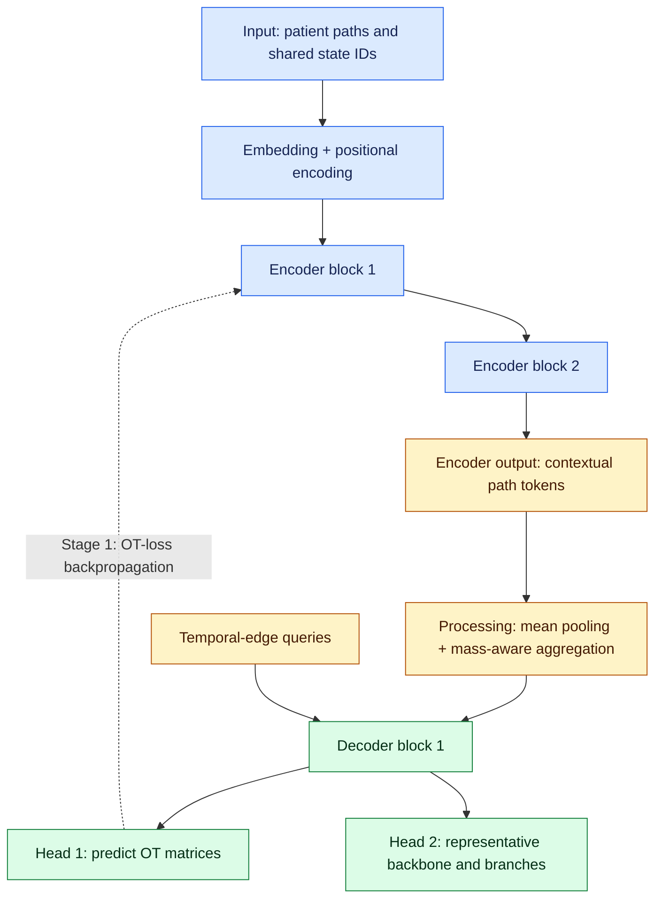
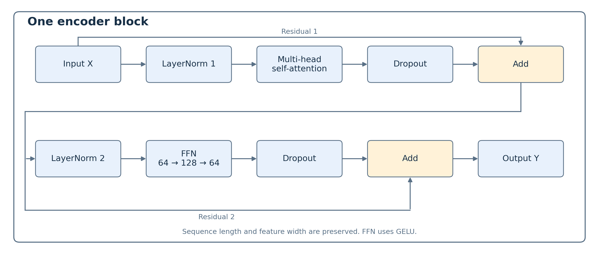
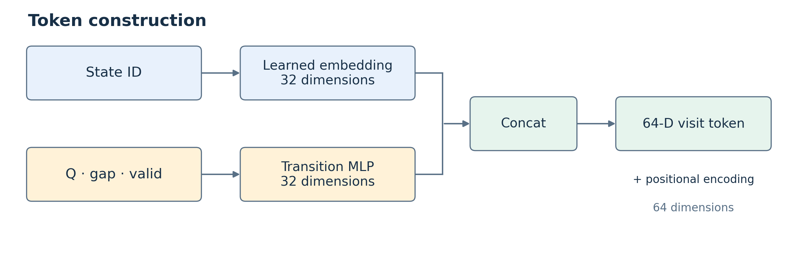
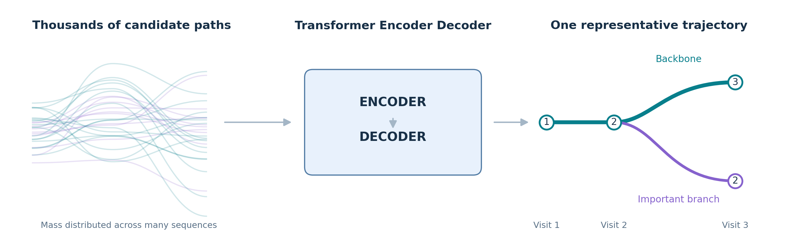

# Transformer Encoder Decoder for Representative Patient Trajectories

**Problem.** OT produces many candidate paths. Across multiple visits, population mass is distributed over many complete sequences, so even highly ranked paths can carry only a small fraction of the total mass. Selecting a few paths can miss shared structure and important branches.

**Solution.** An encoder-decoder Transformer compresses each patient's OT path distribution and reconstructs its transport matrices. A second head uses the learned representation to select **one representative trajectory graph with a backbone and important branches**.

One shared model processes all patients, while preserving each patient's individual input and output. Patient-group labels are used afterward for comparison.

### [Read full manuscript](ot_transformer_manuscript.pdf) · [Download PDF](https://github.com/DavidChen1912/OT-scGHSOM/raw/refs/heads/main/docs/ot_transformer_manuscript.pdf)

## OT-Transformer Encoder–Decoder Architecture

Blue shows path encoding, amber shows patient-level processing and decoder queries, and green shows decoding and outputs. The dashed arrow summarizes Stage 1 parameter updates through the shared network. Stage 2 updates only the structure head.

## Inside an encoder block

Each path passes through **two pre-LayerNorm blocks**. Four attention heads each produce 16-dimensional features, then concatenate and project back to 64 dimensions.

The upper row ends at the first residual Add; the lower row continues through the FFN and second Add. Both additions preserve the token sequence shape.

## Input and embedding

Each patient supplies **candidate state paths, conditional transition probabilities, visit gaps, and full-path masses**. Shared state IDs provide a common cluster vocabulary across patients.

For a path `1 -> 1 -> 2` at days `0, 4, 19`, each visit token combines:

The last visit uses `valid = 0`. Actual gaps preserve irregular sampling intervals. Full-path mass is stored separately and derived by Markov chaining of adjacent OT transitions. Marker profiles and coordinates provide biological context for interpretation.

## From paths to patient summaries

Mean pooling over visits produces one vector per path. **Single-head, mass-aware cross-attention** aggregates these vectors into `[S, 64]` patient summaries using shared learned queries. The summary capacity is denoted by `S`; the worked example uses `S = 2`.

The decoder receives these summaries and temporal-edge queries identifying the source state, target state, interval position, and time gap. One cross-attention block, with LayerNorm, residuals, and an FFN, produces a 64-dimensional representation for each candidate edge.

| Worked example: two states, three visits | Shape |
|---|---|
| Eight paths entering the encoder | `[8, 3, 64]` |
| Mean-pooled path vectors | `[8, 64]` |
| Patient summaries | `[S, 64]`, example `[2, 64]` |
| Decoder edge representations | `[8, 64]` |

## Two heads, two training stages

| Stage | Output and objective | Parameters updated |
|---|---|---|
| **1. Reconstruct OT** | Linear head + per-interval softmax; minimize KL divergence from original OT | Encoder, decoder, OT head |
| **2. Extract representative structure** | Linear-sigmoid head; preserve path mass while limiting retained edges | Structure head; shared network frozen |

The structure objective is:

Soft coverage uses the product of retention gates along each path. After training, gates select edges; incomplete fragments are removed. The highest-original-mass retained path defines the backbone, and its connected component supplies the branches. Retained and excluded path mass quantify the summary's fidelity.

## Output: one backbone with important branches

The diagram illustrates the intended output form. Nodes represent a state at a particular visit, so two nodes labeled state 2 can occupy different times.

Each patient receives one trajectory graph, a designated backbone, and an edge table linking retained transitions to their original OT masses and learned gates. Comparisons use the same model and extraction rules across patients.

